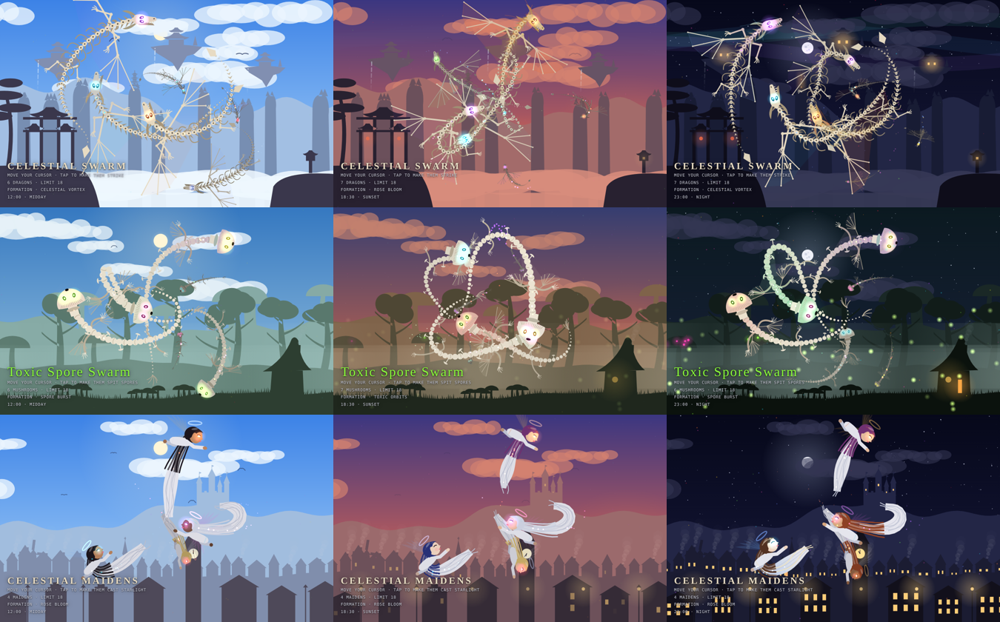

# Cursor Swarms

Five self-contained HTML5 canvas scenes in three worlds. No build step, no dependencies: open any `.html` file in a browser.

| Page | Scene | Creatures |
|---|---|---|
| `bone-dragon.html` | Heavenly mountains: karst peaks with pagodas, floating temple islands, celestial gate, sea of clouds, aurora | Bone dragons that grow celestial skins and beards (original) |
| `celestial-dragon.html` | Heavenly mountains (same scene) | Celestial Eastern dragons that materialize from starlight, wear royal mantles that lengthen with age and chase glowing pearls |
| `dragon-realistic.html` | Heavenly mountains (same scene) | Realistic, richly scaled dragons with painted heads; the mantle can be toggled on or off |
| `mushroom-swarm.html` | Enchanted toxic forest: giant mushrooms, twisted trees, witch's hut, fog, fireflies | Poisonous mushroom creatures that ripen into toxic colors |
| `celestial-maidens.html` | Hillside village and old town: castle, church, windmill, clock tower, street lamps | Winged celestial maidens in flowing gowns |



## Behaviour (all pages)

- **Cursor rings**: heads spread evenly on rings around the cursor and always face it, leaving the centre clear.
- **Tap / click**: the whole swarm lunges and fires particles at the cursor.
- **Idle formations** (2.5 s without moving): Vortex, Orbits, Infinity Chase, Rose Bloom, Supernova/Burst. Switches every 9 s.
- **Life cycle**: newcomers fly in from the edges; skins / colours bloom over time; at the end of their lifespan they ascend and leave a star (or a glowing mushroom on the forest floor).
- **Day–night cycle**: one full day every 160 s (sunrise, noon, golden hour, sunset, dusk, night) with moving sun and moon, clouds, birds, and windows and lanterns that light up at night. The current time is shown bottom-left.
- Respects `prefers-reduced-motion`.

## Run locally

Open `index.html` in a browser, or serve the folder with Node.js (no install needed):

```bash
npx serve .
```

Then open the address it prints (usually http://localhost:3000).

## Publish with GitHub Pages

Settings → Pages → Source: *Deploy from a branch* → Branch: `main` / root. The landing page is `index.html`.
